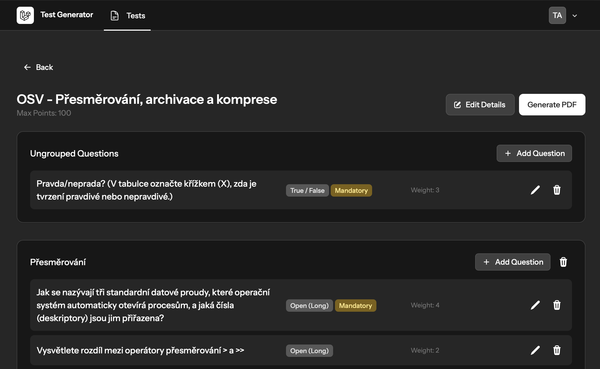
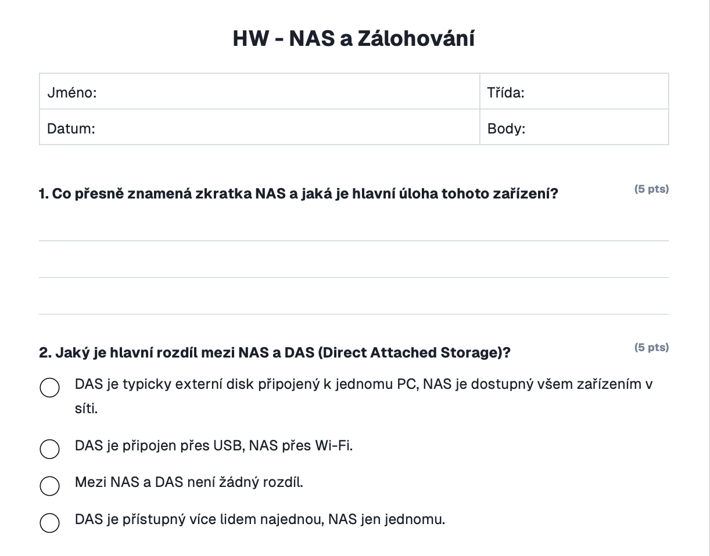

# School Test Generator

A Laravel web application for teachers to build, manage, and export school tests as PDFs. Tests are composed of questions organised into groups, with support for mandatory questions, weighted scoring, and randomised multi-copy generation.




## Features

- **Test management** — create and edit tests with a configurable maximum point total
- **Question types** — open (short), open (long), closed (multiple choice), and true/false
- **Question groups** — organise questions into named groups for structured tests
- **Mandatory questions** — mark questions that must always appear in every generated copy
- **Weighted scoring** — assign weights to questions; points are distributed proportionally using the Largest Remainder Method so totals always sum exactly to the configured maximum
- **Randomised generation** — configure how many questions to draw from each group and generate up to 50 unique copies in a single PDF
- **PDF export** — download generated test copies as a formatted PDF via DomPDF
- **Authentication** — user accounts with profile management, password change, and optional two-factor authentication (Laravel Fortify)

## Tech Stack

| Layer | Package |
|---|---|
| Framework | Laravel 12 / PHP 8.3 |
| Frontend | Livewire 4 + Flux UI 2 |
| Styling | Tailwind CSS 4 |
| PDF | barryvdh/laravel-dompdf |
| Auth | Laravel Fortify |
| Testing | Pest 4 |
| Asset bundling | Vite + Bun |

## Requirements

- PHP 8.3+
- Composer
- Bun (or Node.js + npm)
- SQLite (default) or any Laravel-supported database

## Getting Started

```bash
# Install PHP dependencies
composer install

# Copy environment file and generate app key
cp .env.example .env
php artisan key:generate

# Run database migrations
php artisan migrate

# Install JS dependencies and build assets
bun install
bun run build
```

Start the development server:

```bash
composer run dev
```

This starts the Laravel dev server, queue worker, log watcher, and Vite in parallel.


## Usage

1. Register or log in
2. Create a new test and set its name and maximum points
3. Add questions to the test, assigning a type, weight, and optional group
4. Mark any questions that must always appear as mandatory
5. Go to the **Generate** page for a test, configure how many questions to draw per group, set the number of copies, and click **Generate** to download the PDF


### Example Generated Test

